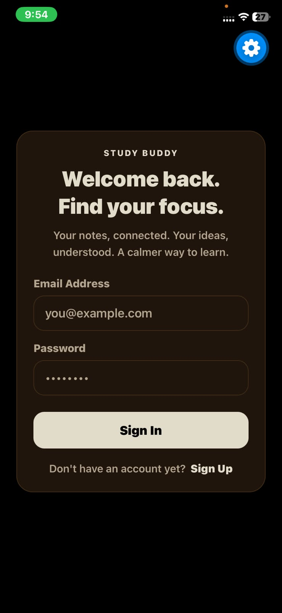
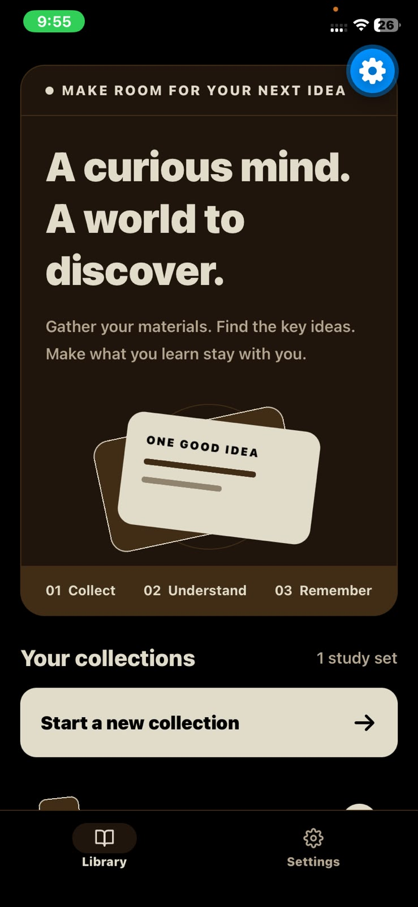
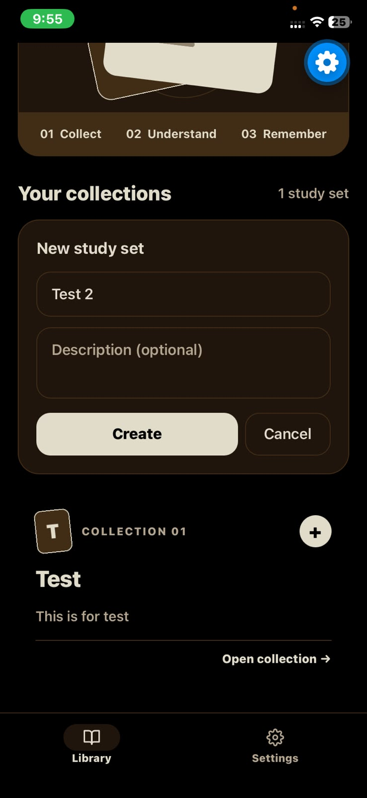
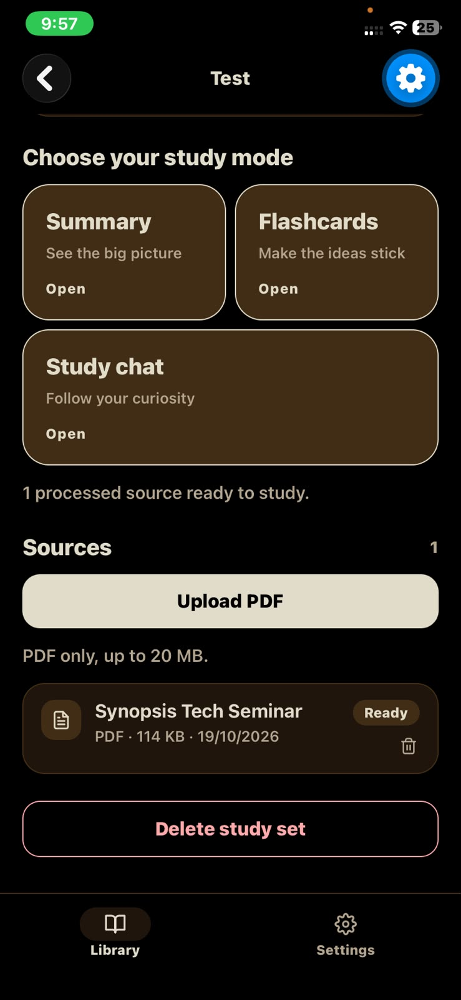
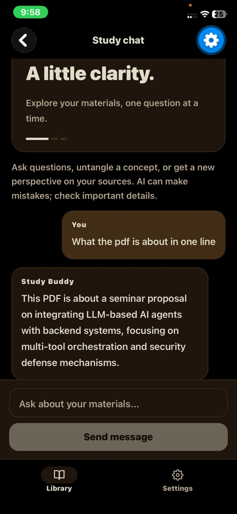
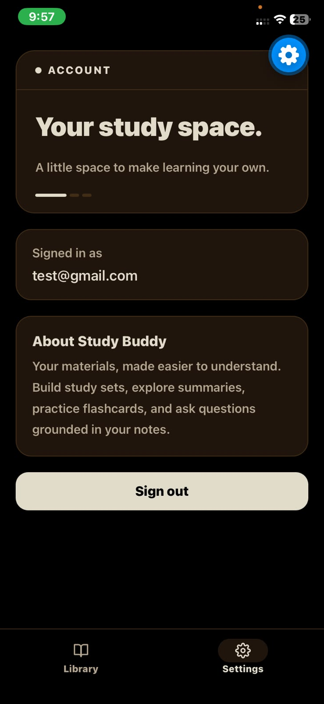

# AI Study Buddy

An Expo/React Native study app. Organize PDFs into study sets, then use AI to
build summaries, generate flashcards, and ask questions grounded in your
material.

The app is a mobile client for Supabase plus a small Express server that does
PDF extraction, chunking, and Anthropic-backed generation.

## Screenshots

| Sign in | Library | New study set |
| :-: | :-: | :-: |
|  |  |  |

| Study set | Study chat | Settings |
| :-: | :-: | :-: |
|  |  |  |

## Features

- Email/password auth with a persisted session and 1:1 user profile.
- Study set library: create, list, open, and delete sets (deletion also removes
  stored PDFs).
- PDF upload to private Supabase Storage, with server-side text extraction and
  chunking.
- AI summary per study set (latest summary is shown).
- Flashcard decks with 6/12/20 card generation and a flip-card review flow.
- Study chat grounded in processed sources using keyword retrieval.
- Retry for queued or failed source processing.
- Dark, warm visual theme.

## Tech stack

**App**

- Expo SDK `~57.0.30`, React Native `0.86.3`, React `19.2.3`
- Expo Router `~57.0.28` (file-based routing in `src/app/`)
- TypeScript `~6.0.3`, strict mode
- TanStack Query `^5.104.4`
- Supabase JS `^2.117.3`
- `expo-sqlite` local storage for session persistence on native

**Server** (`server/`)

- Express `^5.3.0` on TypeScript, run with `tsx`
- Vercel AI SDK `^7.0.143` + `@ai-sdk/anthropic ^4.0.82`
- Zod `^4.6.7` for AI JSON validation
- `pdf-parse@1.1.1` for PDF text extraction
- Supabase service role client for trusted database and storage access

**Database / storage**

- Supabase Postgres with Row Level Security on every table
- Private storage bucket `study-materials`

## Requirements

- Node.js 22+ and npm
- A Supabase project
- An Anthropic API key
- Expo Go or a development build on a simulator/device (or the web target)

## Setup

### 1. Install app dependencies

```bash
npm install
```

### 2. Configure the app environment

Copy `.env.example` to `.env` and fill in the values:

```bash
EXPO_PUBLIC_SUPABASE_URL=https://your-project-id.supabase.co
EXPO_PUBLIC_SUPABASE_PUBLISHABLE_KEY=your-supabase-publishable-or-anon-key
EXPO_PUBLIC_API_URL=http://localhost:3001
```

`EXPO_PUBLIC_API_URL` is the address of the study server. Use
`http://localhost:3001` for a simulator or web. For a physical device, use your
computer's LAN IP (for example `http://192.168.1.38:3001`) and make sure the
device is on the same network.

### 3. Apply database migrations

Run the SQL files in `supabase/migrations/` in filename order against your
Supabase project. You can paste them into the Supabase Dashboard SQL Editor, or
link the project and push with the CLI:

```bash
npx supabase link --project-ref <your-project-ref>
npx supabase db push
```

The migrations create:

- Enums for source type, processing status, and message role
- `profiles`, `study_sets`, `sources`, `source_chunks`
- `summaries`, `flashcard_decks`, `flashcards`
- `conversations`, `messages`
- RLS policies for every table
- The `profiles` signup trigger and backfill
- The private `study-materials` storage bucket and its policies
- Indexes for list views and foreign keys

A final repair migration (`20261019000008_repair_profiles_and_policies.sql`)
recreates the signup trigger and backfills existing users.

### 4. Configure and start the study server

Copy `server/.env.example` to `server/.env` and fill in:

```bash
PORT=3001
SUPABASE_URL=
SUPABASE_ANON_KEY=
SUPABASE_SERVICE_ROLE_KEY=
ANTHROPIC_API_KEY=
ANTHROPIC_CHAT_MODEL=claude-sonnet-4-5
```

Then:

```bash
cd server
npm install
npm run dev
```

Keep `SUPABASE_SERVICE_ROLE_KEY` and `ANTHROPIC_API_KEY` on the server only.
`ANTHROPIC_CHAT_MODEL` is optional and defaults to `claude-sonnet-4-5`.

The server logs `http://localhost:<port>` on startup and listens on all network
interfaces, so a device on the LAN can reach it.

### 5. Start the app

```bash
npx expo start
```

## Environment variables

| Variable | Where | Purpose |
| --- | --- | --- |
| `EXPO_PUBLIC_SUPABASE_URL` | app `.env` | Supabase project URL |
| `EXPO_PUBLIC_SUPABASE_PUBLISHABLE_KEY` | app `.env` | Supabase publishable/anon key (safe for client) |
| `EXPO_PUBLIC_API_URL` | app `.env` | Base URL of the study server |
| `PORT` | `server/.env` | Server port, default `3001` |
| `SUPABASE_URL` | `server/.env` | Supabase project URL |
| `SUPABASE_ANON_KEY` | `server/.env` | Anon key used to validate user tokens |
| `SUPABASE_SERVICE_ROLE_KEY` | `server/.env` | Trusted key for server-side DB/storage access |
| `ANTHROPIC_API_KEY` | `server/.env` | Anthropic API key |
| `ANTHROPIC_CHAT_MODEL` | `server/.env` | Model id, default `claude-sonnet-4-5` |

## How it works

### PDF pipeline

1. The app inserts a `sources` row with `status = 'pending'`, then uploads the
   PDF to `study-materials/<user_id>/<study_set_id>/<timestamp>.pdf`.
2. The app calls `POST /sources/:id/process`.
3. The server atomically claims the source (only `pending` or `failed` can be
   claimed), downloads the PDF, extracts text with `pdf-parse`, and normalizes
   and chunks it (2000 characters per chunk, 200 character overlap,
   `token_count = ceil(length / 4)`).
4. Chunks are written to `source_chunks` and the source becomes `ready`. Errors
   set `status = 'failed'` with an `error_message`.
5. A source already `processing` or `ready` returns `409` so duplicate work is
   avoided.

### AI features

- **Summary** loads up to 24,000 characters of ready source text and asks the
  model for a Markdown study summary. Summaries are stored with the model id and
  prompt version (`summary-v1`); the UI shows the latest.
- **Flashcards** load the same study-set text and ask for strict JSON, validated
  with Zod. Count defaults to 12 and is clamped to 1-20. Decks and cards are
  persisted; a failed card insert rolls back the deck.
- **Chat** retrieves up to 8 relevant chunks with keyword search (stop words
  removed, top 12 terms, up to 128 candidate chunks, ranked by term hit ratio),
  includes the last 10 messages, and persists user/assistant messages. Source
  chunk ids are stored on the assistant message metadata.

Retrieval is keyword-based; there are no embeddings or vector search.

### Ownership and security

- Every table has RLS enabled. Rows are scoped to `auth.uid()` directly or
  through their parent row.
- Storage ownership uses the first path segment: `{user_id}/...`. Users can only
  read/write/delete files under their own id.
- The server requires a bearer token (`Authorization: Bearer <access_token>`, or
  an `x-access-token` header) and validates it against Supabase before handling
  protected routes.
- `ensureProfile()` upserts the app user's profile before user-owned inserts so
  foreign keys to `profiles` are satisfied.
- Deleting a study set removes its storage objects first, then deletes the
  database rows (which cascade to sources, chunks, summaries, decks, and chats).

## API

All protected routes require a bearer token.

| Method | Route | Body | Description |
| --- | --- | --- | --- |
| `GET` | `/health` | - | Health check, returns `{ status: "ok" }` |
| `GET` | `/me` | - | Returns the authenticated `userId` |
| `POST` | `/sources/:id/process` | - | Extract, chunk, and index one PDF source |
| `POST` | `/study-sets/:id/summary` | - | Generate and store a summary |
| `POST` | `/study-sets/:id/flashcards` | `{ count?: number }` | Generate and store a flashcard deck |
| `POST` | `/conversations/:id/chat` | `{ message: string }` | Get a grounded chat reply |

## Data model

- `profiles` — 1:1 with `auth.users`
- `study_sets` — a user's collection
- `sources` — PDFs (schema also allows `note`/`web` for later); tracks status and
  `storage_path`
- `source_chunks` — chunked source text used for retrieval and generation
- `summaries` — generated summaries (multiple kept, latest shown)
- `flashcard_decks` → `flashcards` — generated decks and cards
- `conversations` → `messages` — chat threads and messages, with source ids in
  message metadata

## Project structure

```text
src/
  app/                 Expo Router routes and layouts
    (tabs)/            Library + Settings tabs
      (library)/       Library list and study set screens
        [studySetId]/  detail, summary, flashcards, chat
    sign-in.tsx
  components/          Reusable UI (cards, rows, buttons, feedback)
  constants/           Theme tokens and storage constants
  context/             Auth provider
  features/            Feature queries and actions (auth, sources, study sets)
  lib/                 Supabase client, navigation options, API client
  providers/           TanStack Query provider

server/
  src/
    app.ts             Express app, CORS, routes, error handler
    index.ts           Server entry
    env.ts             Environment loading/validation
    lib/               AI model, Supabase admin client, text search
    middleware/        Bearer-token auth
    routes/            sources, summaries, flashcards, chat
    services/          PDF extraction, chunking, ingestion, RAG helpers
    types/             Express and pdf-parse type declarations

supabase/
  migrations/          Schema, RLS, storage, indexes
```

## Screens

- Sign in (`src/app/sign-in.tsx`)
- Library (`src/app/(tabs)/(library)/index.tsx`) — study set list and creation
- Study set detail (`.../[studySetId]/index.tsx`) — sources, upload, retry,
  delete, mode navigation
- Summary (`.../[studySetId]/summary.tsx`)
- Flashcards (`.../[studySetId]/flashcards.tsx`)
- Study chat (`.../[studySetId]/chat.tsx`)
- Settings (`src/app/(tabs)/settings.tsx`) — account info and sign out

## Scripts

App (repo root):

```bash
npm run start       # start the Expo dev server
npm run android     # start on Android
npm run ios         # start on iOS
npm run web         # start on web
npm run lint        # lint with the Expo ESLint config
npm run typecheck   # TypeScript, no emit
```

Server (`server/`):

```bash
npm run dev         # start with tsx watch
npm run start       # start once with tsx
npm run typecheck   # TypeScript, no emit
```

There is no automated test suite. Verify changes with typecheck, lint, and a
quick manual run. Useful checks:

```bash
npx tsc --noEmit
npx expo lint
npx expo-doctor
```

## Notes and limitations

- Only PDF sources are exposed in the UI.
- PDF processing is synchronous; `POST /sources/:id/process` returns after the
  source is ready or failed.
- Retrieval is keyword-based, not semantic. Re-uploading or reprocessing a
  source refreshes its chunks.
- If the study server is unreachable during processing, the source stays
  `pending` and can be retried once the server is reachable.
- AI output can be wrong; verify important details against the original
  documents.

## Learn more

- [Expo documentation](https://docs.expo.dev/)
- [Expo Router](https://docs.expo.dev/router/introduction/)
- [Supabase with Expo](https://docs.expo.dev/guides/using-supabase/)
- [TanStack Query](https://tanstack.com/query/latest)
- [Vercel AI SDK](https://ai-sdk.dev/)
